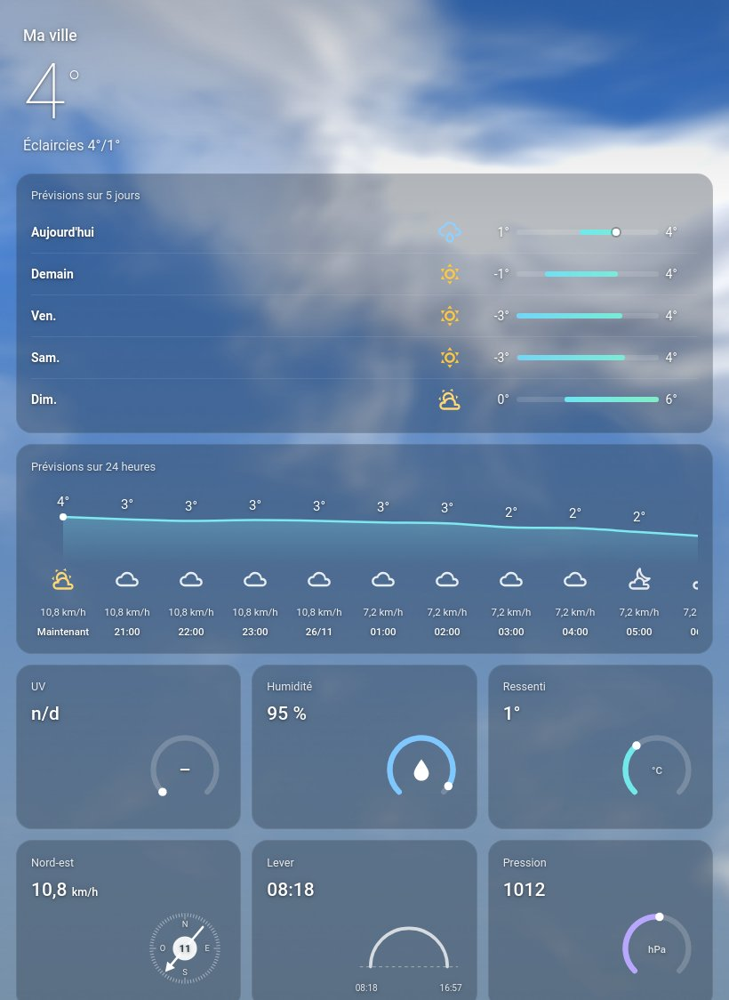
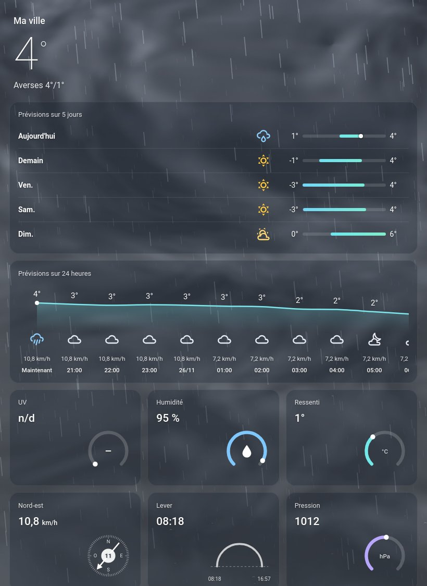
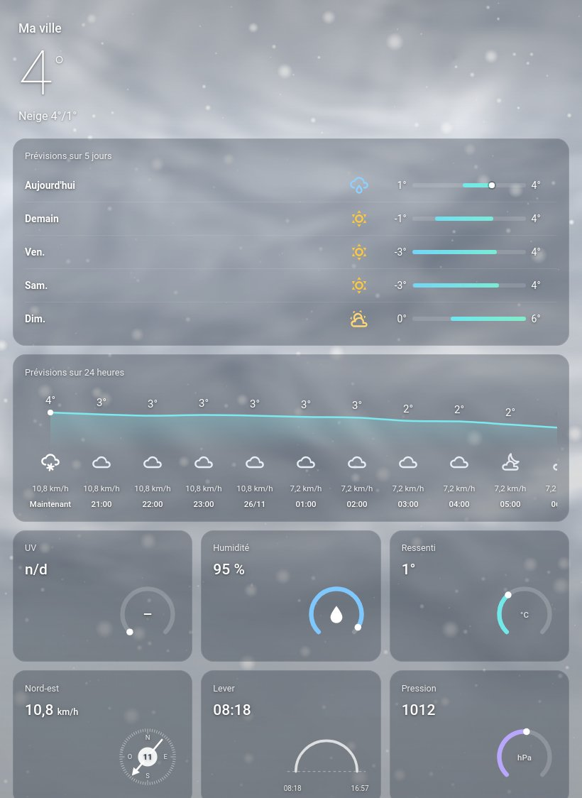
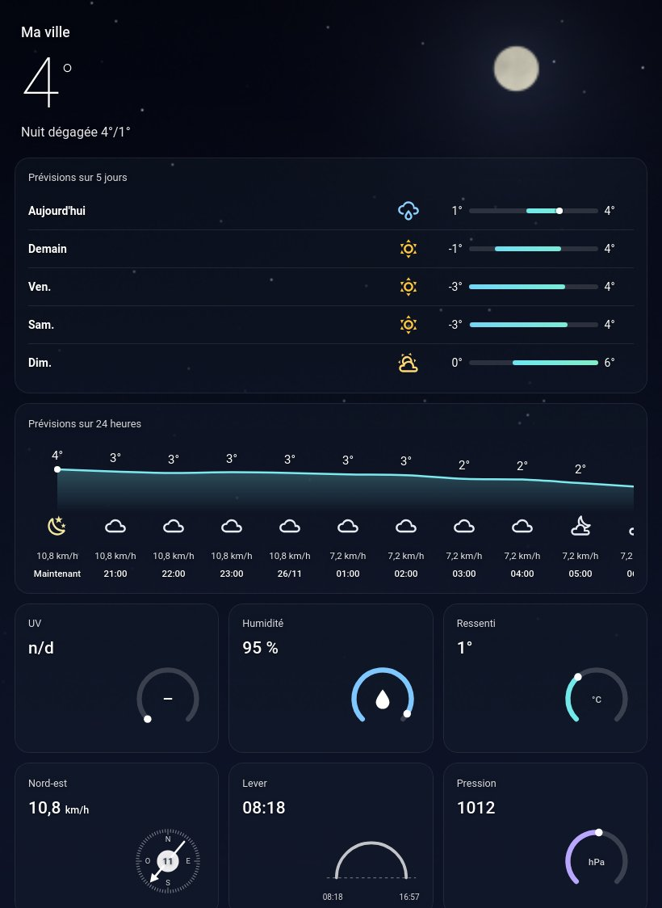

<p>
  ☕ <strong>Si cette carte vous est utile, vous pouvez soutenir le projet :</strong>
</p>

<div style="white-space: nowrap; line-height: 0;">
  <a
    href="https://www.buymeacoffee.com/Marlboro62"
    target="_blank"
    rel="noopener noreferrer"
    style="display: inline-block; text-decoration: none; vertical-align: middle;"
  ></a>&nbsp;&nbsp;<a
    href="https://ko-fi.com/M4M2QL45X"
    target="_blank"
    rel="noopener noreferrer"
    style="display: inline-block; text-decoration: none; vertical-align: middle;"
  ></a>
</div>

# Carte Météo Animée

[](https://hacs.xyz/)
[](https://github.com/Marlboro62/ha-meteo-anime-card/releases)

Carte Lovelace pour Home Assistant inspirée des applis météo des tablettes : **le fond s'anime selon la météo en direct**. Ciel calculé en temps réel, nuages en volume éclairés par le soleil, pluie, neige, orage, brouillard… et toutes les infos utiles par-dessus.

Pensée pour une **tablette murale** (plein écran, mode kiosque), elle fonctionne avec **Météo-France**, **OpenWeatherMap** et n'importe quelle autre entité `weather.*` (Met.no, AccuWeather…). Les relevés et les prévisions peuvent venir de deux sources différentes.

🎮 **[Essayer la démo en ligne](https://marlboro62.github.io/ha-meteo-anime-card/docs/demo.html)** : la vraie carte avec des données simulées, sans installer Home Assistant. Choisissez une météo, le jour ou la nuit, le vent, et regardez le ciel changer.

| Éclaircies | Averses | Neige | Nuit claire |
| --- | --- | --- | --- |
|  |  |  |  |

*Les captures sont fixes : sur la carte, les nuages dérivent, la pluie et la neige tombent, les éclairs illuminent le ciel.*

## Ce que la carte affiche

- **Fond animé qui suit la météo en direct**
  - **Ciel en WebGL** : nuages volumétriques générés en temps réel, éclairés par le soleil (placé selon sa vraie position grâce à `sun.sun`), lueurs de l'aube et du crépuscule, lune et étoiles qui scintillent, brouillard qui dérive.
  - **Pluie** sur trois plans de profondeur avec éclaboussures, **gouttes qui glissent sur la vitre**, **neige** en flocons flous au premier plan, **grêle** qui rebondit, **éclairs** ramifiés qui illuminent les nuages.
  - Le vent accélère les nuages et incline la pluie. Les changements de météo se font **en fondu progressif**.
- **Température actuelle**, condition en français et min/max du jour.
- **Vigilance Météo-France** (jaune, orange, rouge) avec les risques concernés.
- **Prévisions sur 5 jours** : vent, icône, probabilité de pluie, barres min/max colorées et position de la température actuelle.
- **Prévisions sur 24 heures** : courbe des températures, icônes jour/nuit, vent et pluie heure par heure (défilement horizontal).
- **Tuiles** : UV, humidité, ressenti, vent (rose des vents), lever/coucher du soleil, pression.
- Appui sur la température : ouvre la fiche détaillée de l'entité météo.

Si le navigateur ne gère pas le WebGL (ou si la puce graphique décroche), la carte **repasse automatiquement** sur un rendu plus léger en CSS, lui aussi animé.

## Installation

### Avec HACS / Marketplace (recommandé)

1. Dans HACS (ou **Paramètres → Marketplace** depuis Home Assistant 2026.11), cherchez **Carte Météo Animée** et installez-la.
2. Rechargez la page (Ctrl+F5).

Si la carte n'apparaît pas encore dans la recherche, ajoutez le dépôt à la main : menu **⋮** → **Dépôts personnalisés**, adresse `https://github.com/Marlboro62/ha-meteo-anime-card`, type **Tableau de bord** (Dashboard), puis cherchez **Carte Météo Animée**.

### Manuellement

1. Téléchargez [`meteo-anime-card.js`](https://raw.githubusercontent.com/Marlboro62/ha-meteo-anime-card/main/meteo-anime-card.js) (clic droit → Enregistrer sous) et copiez-le dans `/config/www/`.
2. **Paramètres → Tableaux de bord → ⋮ → Ressources → Ajouter une ressource** :
   - URL : `/local/meteo-anime-card.js?v=0.5.0`
   - Type : **Module JavaScript**
3. Rechargez la page (Ctrl+F5).

> À chaque mise à jour manuelle du fichier, changez le `?v=` de la ressource pour forcer le rechargement.

## Configuration

La carte s'ajoute depuis l'éditeur de tableau de bord (**Carte Météo Animée** dans la liste des cartes). Son **éditeur visuel** propose des menus pour choisir chaque entité (météo, vigilance, qualité de l'air, pollen, UV) et régler l'affichage, l'animation et le mode démo, sans écrire de YAML. En YAML :

```yaml
type: custom:meteo-anime-card
entity: weather.ma_ville
alert_entity: sensor.vigilance_meteo_departement
```

Pour une tablette murale, utilisez une vue de type **Panneau (1 carte)** et ajoutez `min_height: 100vh` pour que la carte remplisse l'écran.

| Option | Défaut | Rôle |
| --- | --- | --- |
| `source` | auto | `meteo_france`, `openweathermap` ou `other`. Dans l'éditeur, choisir la source remplit automatiquement l'entité météo et le capteur UV |
| `entity` | — (obligatoire) | Entité `weather.*` des relevés actuels (température, humidité, vent, pression…) |
| `forecast_entity` | `entity` | Entité `weather.*` pour les prévisions, si elle est différente (ex. relevés OpenWeatherMap + prévisions Météo-France) |
| `alert_entity` | — | Capteur de vigilance Météo-France (« … Weather alert »). Bandeau affiché en jaune, orange ou rouge |
| `aqi_entity` | — | Capteur de qualité de l'air. Avec **Atmo France** (« Qualité globale »), la pastille affiche le libellé et la couleur officiels (« Air : Moyen ») |
| `pollen_entity` | — | Capteur pollen (ex. Atmo France « Qualité globale Pollen ») : pastille « Pollen : Très faible » |
| `uv_entity` | auto | Capteur d'indice UV. Par défaut, la carte prend le capteur UV de la même intégration (Météo-France ou OpenWeatherMap) |
| `sun_entity` | `sun.sun` | Jour/nuit, position du soleil, lever/coucher |
| `name` | nom du domicile | Titre en haut de la carte |
| `days` / `hours` | `5` / `24` | Nombre de jours / d'heures de prévisions |
| `show_daily` / `show_hourly` / `show_tiles` | `true` | Afficher ou masquer chaque bloc |
| `show_attribution` | `true` | Ligne « Données fournies par… » |
| `min_height` | `auto` | Hauteur minimale, ex. `100vh` pour remplir l'écran |
| `animations` | `true` | `false` = fond figé (économie de batterie) |
| `quality` | `medium` | Rendu du ciel : `high`, `medium`, `low`, ou `css` (rendu léger, sans WebGL) |
| `fps` | `30` | Images par seconde de l'animation |
| `demo` | `false` | **Mode démo** : enchaîne toutes les météos (soleil, pluie, orage, neige, brouillard, nuit…) |
| `demo_interval` | `12` | Durée de chaque météo en mode démo, en secondes |
| `demo_condition` | — | Forcer une météo (`sunny`, `partlycloudy`, `cloudy`, `rainy`, `pouring`, `lightning-rainy`, `snowy`, `snowy-rainy`, `hail`, `fog`, `windy`, `clear-night`) |
| `demo_night` | — | `true` / `false` pour forcer la nuit ou le jour |
| `debug` | `false` | Affiche en haut à droite le mode de rendu (WebGL ou CSS, et pourquoi), la puce graphique et les images/s |

### Météo-France ou OpenWeatherMap

Au début de l'éditeur visuel, **Source des relevés** propose Météo-France, OpenWeatherMap ou une autre intégration : la carte choisit alors l'entité météo et le capteur UV correspondants.

- **Météo-France** : relevés, prévisions, UV et vigilance, sans clé ni compte. Recommandé en France.
- **OpenWeatherMap** : les relevés fonctionnent dans tous les modes de l'intégration. Les **prévisions et l'UV** demandent un mode qui les fournit (One Call API v3.0). En mode « current » (gratuit, relevés seuls), choisissez une **Source des prévisions** différente, par exemple Météo-France : l'éditeur la propose automatiquement.

```yaml
type: custom:meteo-anime-card
source: openweathermap
entity: weather.openweathermap
forecast_entity: weather.ma_ville   # prévisions Météo-France
```

### Mode démo

Pour montrer la carte (ou vérifier toutes les animations sur votre tablette) sans attendre la bonne météo :

```yaml
type: custom:meteo-anime-card
entity: weather.ma_ville
demo: true
demo_interval: 10
```

Les vraies prévisions restent affichées ; seuls le fond et la condition du moment défilent. Retirez `demo: true` pour revenir à la météo en direct.

## Tablette murale

- **Fully Kiosk Browser** (Android) : plein écran, écran toujours allumé, démarrage automatique.
- Si la tablette rame : `quality: low`, `fps: 20`, ou `quality: css` sur les modèles anciens.
- Le diagnostic `debug: true` indique si la carte utilise bien le WebGL et combien d'images par seconde elle affiche.

## Support

Questions et problèmes : uniquement via les [issues GitHub](https://github.com/Marlboro62/ha-meteo-anime-card/issues).

## Voir aussi

- [Carte Météo](https://github.com/Marlboro62/meteo-card) : cartes météo complètes en français (Météo-France, vigilance, vent, soleil et lune, air, pollens, éclairs…)
- [ISS](https://github.com/Marlboro62/ISS) · [Carte Onduleur UPS](https://github.com/Marlboro62/onduleur-ups-card) · [Cartes Maison](https://github.com/Marlboro62/maison-ha-cards)

## Licence

MIT

## Nom du projet et forks

Ce dépôt est la seule source officielle de **Carte Météo Animée** (releases, HACS, support),
maintenu par [Marlboro62](https://github.com/Marlboro62).

La licence MIT autorise à copier, modifier et redistribuer le code. Si vous publiez une version modifiée :

- gardez les mentions de copyright du fichier [`LICENSE`](https://github.com/Marlboro62/ha-meteo-anime-card/blob/main/LICENSE) (© Marlboro62) ;
- **donnez-lui un autre nom** et un autre type de carte (`custom:meteo-anime-card` est celui de ce dépôt) :
  Home Assistant ne peut pas charger deux cartes du même type, et personne ne doit confondre les deux versions dans HACS ;
- ne la présentez pas comme la version officielle et n'orientez pas vers ce dépôt les demandes
  de support qui concernent votre version.

Une correction ou une idée ? Les **pull requests** et les **issues** sont les bienvenues ici :
elles profitent à tous les utilisateurs.
